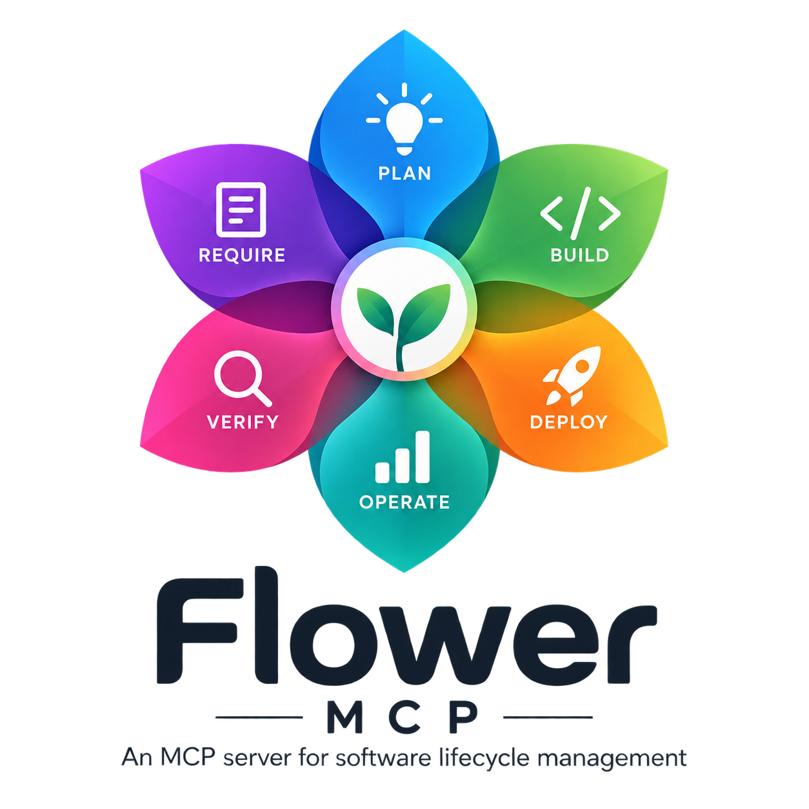

# Flower MCP

<p align="center">
  
</p>

**Persistent software lifecycle management for coding agents.**

Flower connects requirements, milestones and implementation plans to evidence,
verification, acceptance and handover. It stores project state in a SQLite ledger
and exposes it through the Model Context Protocol (MCP), while your coding agent
investigates repositories, writes code and runs checks.

Published release: [0.6.1](https://github.com/Damel91/flower-mcp/releases/tag/v0.6.1) · **In testing** · Python: `3.11+` · [Apache-2.0](LICENSE)

[Quick start](#quick-start) · [English walkthrough](docs/presentation/eng/README.md) · [Presentazione italiana](docs/presentation/ita/README.md) · [Development method](docs/presentation/eng/method.md)

## Flower 0.6.1

The [0.6.1 notes](docs/RELEASE-NOTES-0.6.1.md) and
[lens catalog guide](docs/LENS-CATALOG.md) describe the new read-only
`fow_interaction(operation="catalog")` route. Hosts can present relevant direct
verbs from complete core/primary/companion membership. Flower keeps 37 tools and
445 input fields; selection and execution gates remain explicit.

Flower 0.6.1 is published. The commands below select its verified release
assets; earlier published releases remain unchanged. Source builds and
installer-owned release artifacts remain distinct.
Use the [same-profile upgrade](docs/UPGRADING.md#preparing-a-061-upgrade), preserving
SQLite schema 55, configuration, receipts, evidence and handovers.

## Flower 0.6.0 history

[Flower 0.6.0](https://github.com/Damel91/flower-mcp/releases/tag/v0.6.0) is published.
The [release notes](docs/RELEASE-NOTES-0.6.0.md) describe the compatibility change.
Its immutable assets and compatibility history remain available.

- Milestones separate work realized now from requirements owned by earlier
  milestones. `prerequisite_requirement_ids` replaces `dependency_closure_ids`;
  use `[]` when there are no prerequisites, and refresh the host's tool schema.
- Certified pre-write milestone rejections carry a correlated no-effect receipt.
  Uncertain outcomes require durable inspection before retrying.
- Native hosts can explicitly prepare, inspect, delete and reconcile project
  data with `flower-mcp project-purge`. This is not an MCP tool. Follow the
  [native deletion guide](docs/NATIVE-PROJECT-DELETION.md); Windows native purge
  durability remains unqualified.

Schema 55 and original lifecycle history stay in place. Follow the
[0.6.0 upgrade guidance](docs/UPGRADING.md#preparing-a-060-upgrade) with the same
SQLite profile; project deletion is never an upgrade step. Core remains model-free.

## Why Flower exists

An agent can finish a patch while the requested behavior remains unverified.
A later session needs to know which decisions still apply, which results are
current and what remains open before delivery.

Flower checks declared plan dependencies and verification obligations, applies
lifecycle gates, and preserves result provenance and revisions. A handover
recovers current work and the next gate. Exported Markdown plans support
authorized offline work and reconciliation when Flower returns.

**The model is not the system of record.** Persistence supports the lifecycle;
the purpose is to keep agreed intent, delegated work and evidence connected.

You can start with a scenario: what should the software do and show? Using
Flower's bootstrap guidance, the agent investigates technical gaps and asks
progressive questions about your intent. It records requirements and decisions
in Flower and proposes a roadmap for your confirmation before implementation.
You do not need to define the architecture up front.

## Who does what?

| Participant | Responsibility |
| --- | --- |
| **Person / project authority** | Clarifies intent, confirms scope and makes the acceptance and delivery decisions assigned to them. |
| **Coding agent and its host** | Investigates the repository, chooses the technical implementation, edits code, runs checks and reports outcomes. |
| **Flower MCP** | Maintains lifecycle records, applies its operation gates, tracks evidence provenance and returns durable state. |

The core works without CodingCastle or an internal model. Optional
providers can connect lifecycle records to technical evidence and execution;
see [integration boundaries](docs/presentation/eng/advanced.md) and the
[advanced configuration guide](docs/ADVANCED-CONFIGURATION.md).

### Implemented ≠ verified ≠ accepted

| State | What it means |
| --- | --- |
| **Implemented** | The material work is declared produced. |
| **Verified** | The required checks have passed for the declared scope and relevant current revision, with supporting evidence. |
| **Accepted** | The competent authority has made the required decision. |

Local checks, deferred campaigns and acceptance stay distinct. Results from an
older revision do not automatically satisfy current work.
[Plans, evidence and gates](docs/presentation/eng/concepts.md).

## Example: two people book the same room

*Illustrative scenario from the presentation, not an executed demo or benchmark.*

The requirement: two concurrent requests for the same room and time slot must
produce one confirmation and one explicit conflict. The agent records the requirement and
scenario in Flower, plans bounded work with dependencies and checks, and reports
results against the relevant revision. The implementation remains its job.

Two confirmations would be a defect; recurring bookings would be a new request.
Flower preserves that distinction and the work still awaiting verification.

The walkthrough follows **Require → Plan → Build → Verify → Deploy → Operate**.
These are lifecycle perspectives, not mandatory sequential commands or built-in
deployment and monitoring. Follow the story in
[English](docs/presentation/eng/README.md) or [Italiano](docs/presentation/ita/README.md).

## Quick start

Choose one installation route. Use a writable user directory and have a
**Codex, Claude Code, Cursor, Antigravity or Gemini CLI** client installed. Downloads require Internet
access and trusted HTTPS certificates. Check the
[prerequisites](docs/INSTALLATION.md#prerequisites) first.

For an existing installation, use the [safe upgrade plan](docs/UPGRADING.md)
with its original environment and profile. The commands below require matching
published release assets; changes on `main` do not publish a release.
These download commands select published **0.6.1**. Use the existing environment
and profile when upgrading, so the SQLite ledger and client registration stay in place.

### macOS / Linux

Requires Bash, `curl`, `awk`, `sha256sum` or `shasum`, and standard shell utilities.
Review the [release installer](https://github.com/Damel91/flower-mcp/releases/download/v0.6.1/install.sh) before execution:

```sh
curl -fsSL https://github.com/Damel91/flower-mcp/releases/download/v0.6.1/install.sh | bash
```

The installer prepares an isolated Python environment, obtaining Python if
needed, checks backend and wheel checksums, and offers optional client registration.

### Windows

Requires Windows PowerShell 5.1+. Download the launcher, inspect it, then run the
second command only after the download succeeds:

```powershell
Invoke-WebRequest -UseBasicParsing -Uri "https://github.com/Damel91/flower-mcp/releases/download/v0.6.1/install.ps1" -OutFile ".\install.ps1"
powershell.exe -NoProfile -ExecutionPolicy Bypass -File .\install.ps1 -Platform codex
```

Use `-Platform claude-code`, `-Platform cursor`, `-Platform antigravity`,
`-Platform gemini-cli` or `-NoRegister` as appropriate.
The launcher reuses or prepares Python and installs the checked release wheel.
The execution-policy option applies only to that process.

**Manual alternatives:** [source](docs/INSTALLATION.md#manual-installation-from-source)
or [release wheel with checksum verification](docs/INSTALLATION.md#manual-installation-from-a-release-wheel).
Both require Python 3.11+ with SSL, `venv` and `ensurepip`; cloning also requires
Git. The [installation guide](docs/INSTALLATION.md) covers downloads, upgrades,
profiles, removal and recovery.

**Already using Flower?** Follow the [safe upgrade plan](docs/UPGRADING.md)
to retain the existing SQLite ledger, profile and client registration. Stop all
clients sharing its environment, inspect `--upgrade --dry-run`, then run the
same command without `--dry-run`. Do not reinstall into a different profile.

See [Google client setup](docs/GOOGLE-CLIENTS.md) for Antigravity and Gemini CLI.

### Optional internal inference

Flower `0.6.1` selects the independently published
[runtime-llama `0.5.0`](https://github.com/Damel91/llama-runtime/releases/tag/v0.5.0),
pinned by URL and SHA256 through its optional `inference` extra.
Flower `0.6.0` selected the same SDK. Historical Flower `0.5.2` still selects runtime `0.4.1`; its assets remain immutable. Existing optional installations can update
only the SDK while retaining the installed Flower artifact, receipt and profile;
reinstalling its old extra can select the old SDK again. Historical Flower
`v0.4.1` still requires runtime `0.4.0` and retains its eight assets.
Core installers remain core-only. See [inference setup and migration](docs/INFERENCE.md)
for current-source installation, verified offline downloads and the targeted
SDK-only update.
An operator-managed llama.cpp endpoint is required only for internal inference.
Host-produced semantic results continue to work without a model.
See [advanced configuration](docs/ADVANCED-CONFIGURATION.md) for role selection,
operator YAML, provider contracts, portable associations and explicit execution.

### Glama and containers

The repository includes maintainer metadata and a core-only Dockerfile for
Glama's build workflow. See the [Glama and container guide](docs/GLAMA.md) for
startup arguments, persistent SQLite storage and client setup. Glama account
claim, hosted deployment and platform release are separate steps; the
GitHub `v0.6.0` release includes these container files.

[Glama](https://glama.ai/mcp/servers/Damel91/flower-mcp)'s tool-definition
feedback helped identify the discovery gaps addressed in 0.5.1. The changes
were verified against Flower's code and public operation contracts. Platform
evaluation, hosted deployment and functional acceptance remain separate.

### Connect an agent and start a project

1. **Reload the registered client and approve its MCP connection.** The client
   starts Flower. If you installed without registration, configure the client
   first. Do not start another server process against the same ledger.
2. **Give your agent this request** while working in the project you intend to
   develop. Replace "the installed Flower MCP command" with the executable path
   returned by the installer:

> Run the installed Flower MCP command with `bootstrap` and follow its output
> to update this project's `AGENTS.md`, preserving its existing rules. Verify
> the MCP connection, discover the lifecycle projects and select the intended
> project explicitly. If the ledger is empty, I authorize creating a lifecycle
> project for this repository. Report an ambiguous project choice or a missing
> connection instead of guessing. Read the durable project snapshot and follow
> Flower's current recipes. Help me describe the first scenario, clarify its
> intent progressively and present a roadmap for my confirmation before coding.

The bootstrap command prints instructions; the agent merges them into
`AGENTS.md`. Ensure your host loads those instructions through its supported
mechanism. Project selection and state recovery use Flower's public tools;
the agent follows their current recipes.

For a manual source installation, the bootstrap command is
`.venv/bin/flower-mcp bootstrap` on macOS/Linux or
`& .\.venv\Scripts\flower-mcp.exe bootstrap` in PowerShell, **from the Flower
checkout**. From your application project, use the absolute path to that
executable. A bare `flower-mcp` command works only when it is on `PATH`.

**First-use check:** the agent can see Flower's tools, select the intended
project and retrieve its current snapshot and next gate. `doctor` checks
configuration files; it does not prove the MCP connection. The
[bootstrap guide](docs/BOOTSTRAP.md) includes a ready-to-use agent request.

Already installed? Follow the [SQLite-preserving upgrade plan](docs/UPGRADING.md).
Stop clients sharing the Flower environment, preview with the new installer's
`--upgrade --dry-run` (PowerShell `-Upgrade -DryRun`), then upgrade with the same
environment/profile paths. Flower backs up SQLite and YAML before package
changes. Updating an existing schema 55 installation to 0.6.1 keeps
schema 55 unchanged; older 0.3.1/schema 52 installations use the existing additive
migrations to 55. Resume the existing project and verify another restart.

## Documentation

| Topic | English | Italiano |
| --- | --- | --- |
| Scenario-led walkthrough | [Start here](docs/presentation/eng/README.md) | [Inizia qui](docs/presentation/ita/README.md) |
| Concepts, packet validation and evidence | [Concepts](docs/presentation/eng/concepts.md) | [Concetti](docs/presentation/ita/concepts.md) |
| Public MCP tools | [Tool map](docs/presentation/eng/tools.md) | [Mappa dei tool](docs/presentation/ita/tools.md) |
| Optional providers and technical execution | [Integrations](docs/presentation/eng/advanced.md) | [Integrazioni](docs/presentation/ita/advanced.md) |
| Comparison with related projects | [Comparison](docs/presentation/eng/comparison.md) | [Confronto](docs/presentation/ita/comparison.md) |
| Sources, provenance and limits | [Sources](docs/presentation/eng/sources.md) | [Fonti](docs/presentation/ita/sources.md) |

The [presentation index](docs/presentation/README.md) also links the offline readers.

[Advanced configuration](docs/ADVANCED-CONFIGURATION.md) explains internal LLM
setup, supported host semantic roles and external technical providers. The
[0.6.1 release notes](docs/RELEASE-NOTES-0.6.1.md) and
[lens catalog guide](docs/LENS-CATALOG.md) describe current host discovery.
The [0.5.2 release notes](docs/RELEASE-NOTES-0.5.2.md) record the published
corrections. The [0.6.0 release notes](docs/RELEASE-NOTES-0.6.0.md) and
[native project deletion guide](docs/NATIVE-PROJECT-DELETION.md) describe the new
contracts and their qualification boundaries.

Release 0.4.1 retains [continuous work and recovery](docs/CONTINUOUS-RECOVERY.md):
frozen handovers, current authority, original evidence, offline outcomes and the
installed HTTP probe. Historical 0.3.0 assets remain unchanged.

Release 0.4.1 retains [project architecture and negotiated PVP
handoff](docs/NOXI-INTEGRATION.md). Standalone external
plans remain independent; real provider pairing requires compatible consumer
support and separate qualification.

The 0.4.1 patch preserves every finding when an SRS import or revision is
rejected, including repeated diagnostic codes. It adds no tool or database
migration. Already using Flower? Follow the [upgrade plan](docs/UPGRADING.md)
with the same environment and profile: preview, stop all clients, back up before
pip, update and verify the existing project after restart. Do not reinstall into
a new profile to recover project state.

## Development method

Flower is a personal project by **Davide Mele**, developed outside his
professional work. He designed the system, defined requirements and constraints,
guided verification and made acceptance decisions; coding agents, primarily
**Codex**, carried out repository investigation, technical planning,
implementation, tests and document updates. The work first used a documentary
framework; Flower moves part of that discipline into a persistent server.
Read the method in [English](docs/presentation/eng/method.md) or
[Italiano](docs/presentation/ita/method.md).

A real project managed with Flower is
[llama-runtime](https://github.com/Damel91/llama-runtime). Its requirements,
milestones, implementation packets, plan validation, verification evidence and
handovers are maintained in Flower's persistent project ledger. Flower supports
the library's development lifecycle; installing or using the library does not
require Flower.

## Status and operating limits

Flower `0.6.1` is published and remains in testing. Tag `v0.6.1` identifies
commit `8de41beb1368ef772755b068b7404a91d3197f49`
([release 416461595](https://github.com/Damel91/flower-mcp/releases/tag/v0.6.1)).
[Exact candidate CI](https://github.com/Damel91/flower-mcp/actions/runs/39129035522)
passed six jobs. The [Release workflow, attempt 2](https://github.com/Damel91/flower-mcp/actions/runs/39130028443/attempts/2)
has eight successful job results. Seven anonymous official assets and a fresh
owned macOS HTTPS upgrade from 0.6.0 to 0.6.1 were verified separately, including
SQLite schema 55, existing history, configuration, client paths and restart.
No real user installation was changed for those checks. Published tags and
assets are preserved by maintainer policy; GitHub does not enforce immutability
for this release. Current guides on `main` do not replace its published bytes.
These checks do not certify an unknown OS, model usability, a real client update
or human acceptance. The witness remains deferred.

Historical release checkpoints follow.

Flower `0.6.0` is published and remains in testing. Published tag `v0.6.0` identifies commit `bb43b5a161ecc85e56f1d2dba2c69184da0a02b7` ([release 416096822](https://github.com/Damel91/flower-mcp/releases/tag/v0.6.0)). [Candidate CI](https://github.com/Damel91/flower-mcp/actions/runs/39072677376) and [Release workflow](https://github.com/Damel91/flower-mcp/actions/runs/39073239681) are separate from anonymous asset checks and the populated-profile HTTPS upgrade.
The official assets and a fresh owned 0.5.2/schema55 → 0.6.0/schema55 HTTPS upgrade
were checked separately from source, installed-package and CI checks.
No user installation or real project deletion was used for those checks.
The incompatible milestone input is documented above; refresh the host schema.
The writer witness remains deferred. Windows native purge durability and real
Noxi/client acceptance remain separate qualifications.

Flower `0.5.2` is published and remains in testing. Its
[release notes](docs/RELEASE-NOTES-0.5.2.md), the historical
[0.4.1 release notes](docs/RELEASE-NOTES-0.4.1.md) and
[installation status](docs/INSTALLATION.md#testing-status-and-release-access)
distinguish installed-package and CI checks from end-to-end installer and
target-client qualification.
The patch corrects repeated authority reads and shared-predecessor PVP work in
complete project recovery, preserving full results, gates and the existing
deadlines. It retains 0.5.1's descriptions for all 37 tools and 445 inputs,
conservative MCP annotations and canonical examples, together with the
0.5.0 receipt/error-recovery corrections, explicit sync-only provider delivery
and bounded provider RPCs, with the same callable contracts and schema 55. The writer witness remains deferred; this release does not claim
its integration or cross-server acceptance.
The immutable release archive retains its preparation-era documentation; these
current guides on `main` align installation instructions with the published assets.

Flower's gates govern its server operations, not every action available to the
agent's host. Host-declared evidence is not an independent source audit;
correctness depends on the implementation, checks and oracles behind it.
Optional CodingCastle adapters need compatible services; their presence alone
does not establish that a runtime pairing has been qualified.

To report an issue, include the Flower version, operating system, client,
operation and error in the [issue tracker](https://github.com/Damel91/flower-mcp/issues),
without credentials or private project data.

## License and compatibility

Licensed under [Apache-2.0](LICENSE), with attribution in [NOTICE](NOTICE).
The public command is `flower-mcp`; the Python distribution `flow-of-work-mcp`,
import package `flow_of_work_mcp` and MCP prefix `fow_*` retain their existing names.
